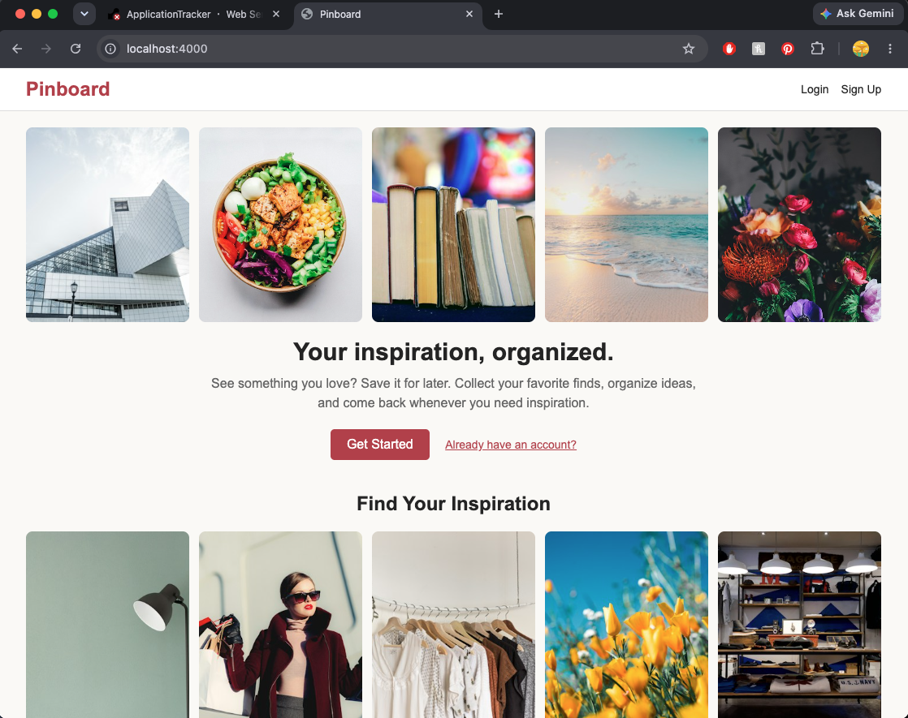

# MERN_App – My Pinboard

My Pinboard is a fullstack web application that allows users to collect and organize things they find interesting online. Whether it's inspiration, products, creative ideas, or useful resources, users can save links and images as pins to keep everything in one place.

Instead of having links scattered across different tabs or bookmarks, My Pinboard makes it easier to save and revisit them.

### Live Link
[My Pinboard](https://mern-app-lp0v.onrender.com/)

### Image


### Features
- Users can sign up, log in, and log out.
- Create pins by adding an item name, image URL, and other details.
- Organize pins using categories, colors, and tags.
- View saved pins on a personal board.
- Update and delete existing pins.
- Save collections to MongoDB.

### Tools
- **HTML & CSS** – Structure and styling
- **JavaScript** – Front-end and back-end functionality
- **Node.js** – Server-side JavaScript
- **Express.js** – Routes and handling requests
- **MongoDB** – Storing user accounts and saved pins
- **EJS** – Displaying dynamic content
- **Passport.js** – User authentication

### Instructions

1. Clone the repository:
   ```bash
   git clone https://github.com/KinzaRehman/MERN_App.git
   ```

2. Navigate to the project:
   ```bash
   cd MERN_App
   ```

3. Install dependencies:
   ```bash
   npm install
   ```

4. Create a `.env` file and add your MongoDB connection string and session secret:
   ```env
   MONGO_URI=your_mongodb_connection_string
   SESSION_SECRET=your_session_secret
   ```

5. Start the application:
   ```bash
   npm start
   ```

6. Open `http://localhost:3000` in your browser (or whichever port is configured).


### Future Improvements
- Allow users to upload images directly instead of pasting URLs.
- Add a search feature to find pins by name or category.
- Allow users to create separate boards for different interests.
- Improve the layout and responsiveness of the pinboard.
